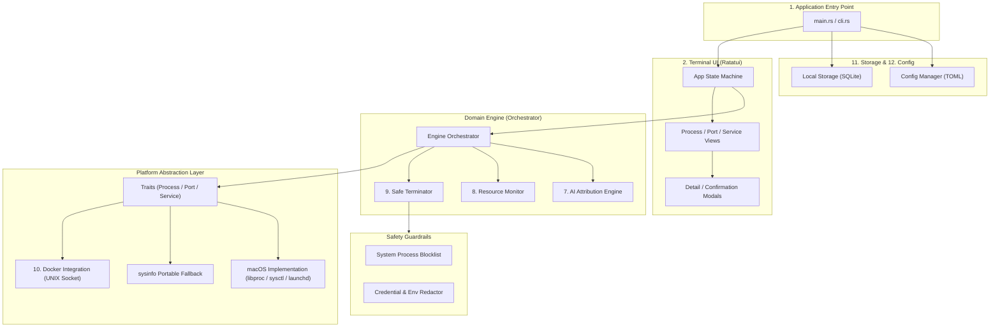
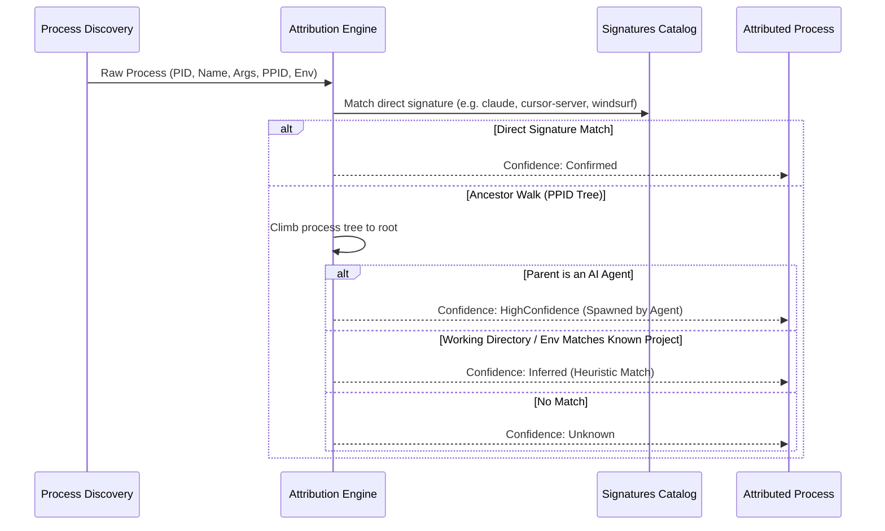
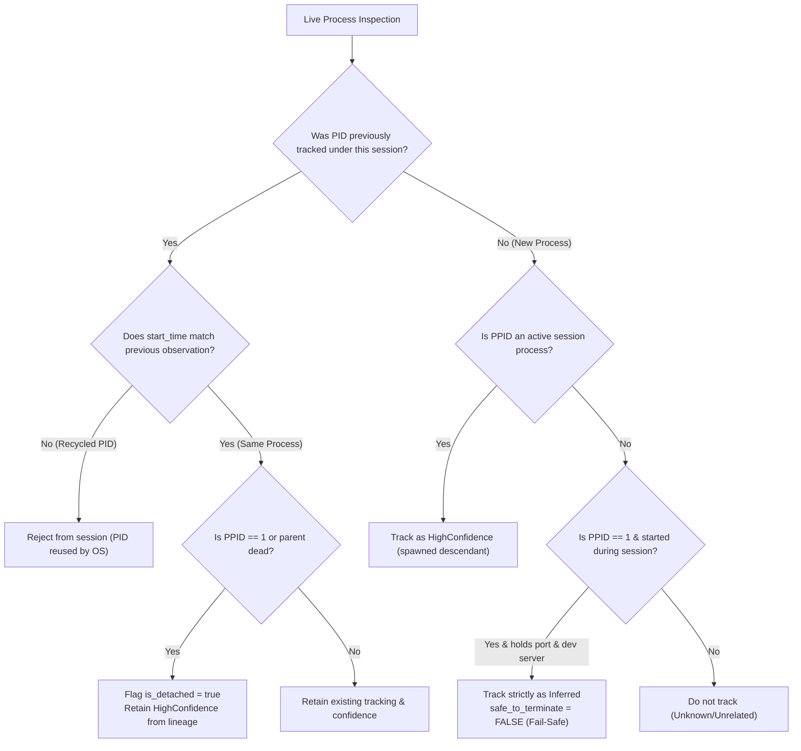
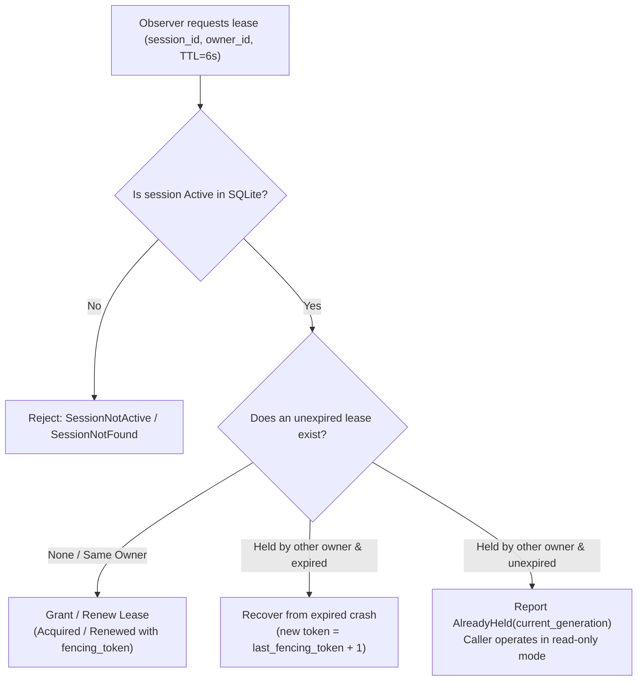
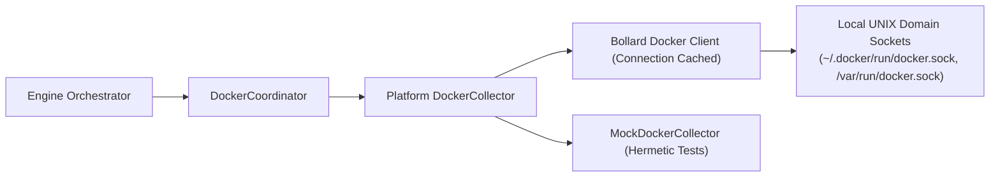
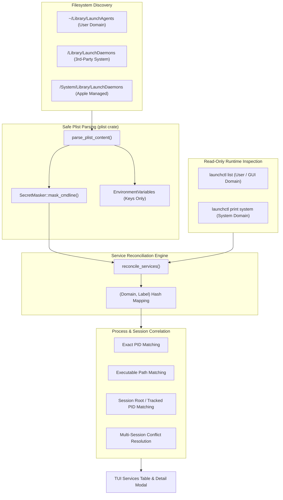

# TIMMY Architecture Document

## 1. System Vision & Architecture Principles

**TIMMY** is designed as a modular, high-reliability systems utility for macOS (and future POSIX/Windows systems). The architecture prioritizes:
- **Strict Decoupling**: Business logic, discovery, attribution, and persistence are completely independent of the presentation layer (TUI).
- **Zero-Daemon Overhead**: TIMMY runs strictly on-demand. No long-running background services or background polling daemons are required.
- **Portability by Design**: Platform-specific discovery mechanisms are isolated behind clean Rust traits (`ProcessCollector`, `PortCollector`, `ServiceCollector`).
- **Safety by Default**: Irreversible system operations require confirmation, follow graceful escalation paths, and enforce strict, immutably coded safety boundaries.
- **Local-First & Private**: Attribution and inspection run 100% locally with zero external network dependencies and complete redaction of sensitive credentials.

---

## 2. The 12 Architectural Responsibilities

The system divides functionality into 12 distinct components:

| Responsibility | Module | Purpose |
|:---|:---|:---|
| **1. Application Entry** | `crate::main`, `crate::cli` | Parses CLI flags, sets up logging, initializes panic hooks, manages TUI lifecycle. |
| **2. Terminal User Interface** | `crate::ui` | Ratatui + Crossterm TUI: layout rendering, stateful widgets, keyboard event loop, modals. |
| **3. Process Discovery** | `crate::engine::discovery` | Gathers running processes, parent-child process relationships, and life-cycle metadata. |
| **4. Process Inspection** | `crate::engine::inspection` | Deeply inspects command-line arguments, working directories, open file descriptors, and sanitized env. |
| **5. Network & Port Discovery** | `crate::engine::ports` | Correlates listening TCP/UDP sockets with PIDs and process names. |
| **6. Background Service Discovery** | `crate::engine::services` | Discovers user-level launchd agents, system daemons, and developer service status. |
| **7. AI-Agent Attribution** | `crate::engine::attribution` | Heuristic engine matching process lineage, parent processes, cwd, and command lines to AI agents. |
| **8. Resource Monitoring** | `crate::engine::monitor` | Calculates CPU percentage, resident memory (RSS), thread counts, and historical usage deltas. |
| **9. Safe Process Termination** | `crate::engine::terminator` | Enforces safety guardrails, sends `SIGTERM`, verifies termination, and escalates to `SIGKILL` only upon confirmation. |
| **10. Docker Integration** | `crate::engine::docker` | Connects to Docker daemon via UNIX socket to identify developer containers, ports, and parent contexts. |
| **11. Local Storage** | `crate::storage` | SQLite persistence for agent signature catalog, session tracking, kill history, and user allowlists. |
| **12. Configuration Management** | `crate::config` | Parses and validates TOML configuration, default rules, safety overrides, and custom agent signatures. |

---

## 3. High-Level Architecture Diagram



---

## 4. Platform Abstraction Layer (Cross-Platform Ready)

To prevent coupling discovery logic to macOS-specific internals, platform interactions are specified via traits in `src/platform/traits.rs`:

```rust
pub trait ProcessCollector: Send + Sync {
    fn collect_processes(&self) -> Result<Vec<ProcessInfo>, PlatformError>;
    fn inspect_process(&self, pid: u32) -> Result<ProcessDetail, PlatformError>;
}

pub trait PortCollector: Send + Sync {
    fn collect_listening_ports(&self) -> Result<Vec<ListeningPort>, PlatformError>;
}

pub trait ServiceCollector: Send + Sync {
    fn collect_services(&self) -> Result<Vec<ServiceInfo>, PlatformError>;
}

pub trait DockerCollector: Send + Sync {
    fn collect_containers(&self) -> Result<Vec<ContainerInfo>, PlatformError>;
}
```

### macOS Implementation
- Process discovery uses a hybrid of `sysinfo` for cross-cutting metrics and native macOS APIs via `libproc` (`proc_pidinfo`, `proc_pidpath`, `proc_pidfdinfo`) and `sysctl` (`KERN_PROCARGS2`) for accurate command-line reconstruction and open socket file descriptor inspection.
- Background services inspect launchd jobs via user domain sockets and `launchctl` inspection protocols.
- Network ports correlate socket inodes to process PIDs.

### Future Linux & Windows Implementations
- **Linux**: Reading `/proc/[pid]/`, `/proc/net/{tcp,tcp6}`, and `systemd` user units via D-Bus.
- **Windows**: Toolhelp32 API, `GetExtendedTcpTable`, and Windows Service Manager.

---

## 5. AI-Agent Attribution Engine

AI coding agents spawn tools and child processes through various shell layers. TIMMY uses a multi-tier attribution pipeline:



### Attribution Confidence Tiers
1. **Confirmed**: Process binary directly belongs to an AI agent (e.g., `claude`, `cursor`, `windsurf-server`, `aider`, `github-copilot-cli`).
2. **HighConfidence**: Process was directly spawned as a child/descendant of a Confirmed agent process (e.g., `node /vite/bin/vite.js` spawned by `claude`).
3. **Inferred**: Process matches known AI agent patterns (e.g., spawned in an active agent session folder, listening on a known ephemeral agent port, or carrying agent session environment variables).
4. **Unknown**: Standard user or system process not linked to an AI agent session.

---

## 6. Safety Architecture & Safeguards

Safety is the absolute priority in TIMMY. System destruction or accidental disruption of user workstations must be impossible.

### Safeguard Levels:
1. **Hardcoded Critical Blocklist**:
   PIDs `<= 1`, `WindowServer`, `loginwindow`, `launchd`, `kernel_task`, `Dock`, `Finder`, `syslogd`, `sshd`, `SystemUIServer`, `securityd`, `mds`, and other core macOS Daemons can **never** be targeted. Attempts return `Err(SafetyError::CriticalSystemProcess)`.
2. **Current Self-Protection**:
   TIMMY will never terminate its own process, its parent shell, or its own terminal emulator.
3. **Graceful Termination Escalation**:
   - Level 1: `SIGTERM` (allows servers to flush writes, close ports, and exit cleanly).
   - Level 2: Poll with a 2-5 second timeout.
   - Level 3: If still alive, request explicit second-tier user confirmation in the TUI before issuing `SIGKILL`.
4. **Credential Masking**:
   Process environment inspection passes all key-value pairs through a `SecretMasker` that redacts known patterns:
   - Keys containing: `KEY`, `SECRET`, `TOKEN`, `AUTH`, `PASS`, `CREDENTIAL`, `PRIVATE`.
   - Values matching high-entropy API token formats (e.g., `sk-ant-*`, `ghp_*`, `xoxb-*`, `AKIA*`).
5. **No Shell Subprocessing for Process Kills**:
   Never invoke `sh -c "kill -9 ..."` or `pkill`. All signals are delivered via `libc::kill(pid, signal)` ensuring exact PID targeting and preventing command injection vulnerabilities.

---

## 7. Storage & Configuration Architecture

- **SQLite (`timmy.db`)**:
  - Located in `~/Library/Application Support/timmy/timmy.db` on macOS.
  - Stores:
    - Known agent signatures (bundled defaults + user defined).
    - Termination audit log (timestamp, PID, process name, agent attribution, signal, outcome).
    - Process session history.
- **Configuration (`config.toml`)**:
  - Located in `~/.config/timmy/config.toml` or `~/Library/Application Support/timmy/config.toml`.
  - Configures:
    - Polling/refresh intervals (default: 1000ms).
    - Port watchlists & port ignore lists.
    - Safety rule overrides (allowlists only; system blocklists cannot be disabled).
    - UI themes and keybindings.

---

## 8. Terminal UI Architecture (Ratatui)

- **Unidirectional Data Flow**:
  - `Event Loop` (Crossterm key/mouse events + timer ticks) -> `App::on_event()` -> State Mutation.
  - `Engine::refresh()` -> Updates cached snapshots of processes, ports, and services.
  - `Terminal::draw()` renders pure views based on immutable state snapshot.
- **Terminal Restoration**:
  - Custom panic hook guarantees terminal raw mode is disabled and alternate screen is restored even during an unhandled panic.

---

## 9. AI Agent Session Tracking Architecture

The Session Tracking Subsystem (`crate::engine::session` & `crate::storage`) allows developers to group, monitor, and audit background resources belonging to specific AI agent coding sessions.

### Data Model & Lifecycle States

```
                ┌────────────────┐
                │  timmy session │
                │     start      │
                └───────┬────────┘
                        ▼
                 ┌──────────────┐
                 │    Active    │◄───────────┐
                 └──────┬───────┘            │
                        │                    │ observe_and_update()
         timmy session  │                    │ (TUI or --watch)
             stop       ▼                    │
                 ┌──────────────┐            │
                 │   Stopped    │────────────┘
                 └──────────────┘ (Terminal state: immutable snapshot)
```

Sessions progress across defined states:
- **`Active`**: Session is open. Live observations (`observe_and_update()`) correlate running processes, update memory/CPU stats, detect detached children, and record periodic snapshots.
- **`Stopped`**: Explicitly halted via `timmy session stop`. Becomes an immutable historical record. Inspection or resource queries on stopped sessions return historical snapshots without database mutation.
- **`Completed`**: Archived or finished lifecycle state.

To prevent accidental abandonment of active tracking, attempting `timmy session start` while an active session exists fails with `ActiveSessionAlreadyExists` unless `--replace` is explicitly provided.

### Snapshot vs. Continuous Observation Model

TIMMY strictly adheres to a daemon-free design:
1. **`timmy session start`**: Creates the session record in SQLite, takes an initial observation snapshot of processes, and immediately exits. **No background daemon is spawned**.
2. **`timmy session start --watch` / `timmy session watch`**: Runs a continuous monitoring loop in the foreground at a configurable interval (default: 2 seconds). Observes process life-cycles, detects child spawns and parent exits, and records snapshot metrics. Handles `SIGINT` (Ctrl+C) gracefully, persists the final observation, and exits cleanly.
3. **Interactive TUI**: When `timmy` is running, the TUI loop periodically calls `observe_and_update()` on active sessions on each UI tick. Observation stops cleanly the moment the TUI exits.

### Detached Process Attribution & PID Reuse Verification



1. **Previously Observed Children**: If process $B$ is observed while spawned by agent $A$, TIMMY records $B$'s PID, start time, and binary path. When agent $A$ exits and $B$ re-parents to PID 1, TIMMY confirms $B$ is a detached resource with `HighConfidence`.
2. **Unobserved Orphans**: If a process under PID 1 was never observed under an agent tree, TIMMY **never** assigns it `HighConfidence` or `Confirmed`. It receives strictly `Inferred` attribution with `safe_to_terminate = false`.
3. **PID Reuse Protection**: If an observed process exits and the OS reassigns its PID to a different program, TIMMY verifies `(live.start_time == prev.start_time)`. Mismatches trigger immediate exclusion, preventing false attribution.

### Database Migrations & Fail-Safe Defaults

Session state is persisted with versioned SQLite migrations:
- **`MIGRATION_V1`**: Initial schema (`sessions`, `session_resources`, `session_snapshots`, `audit_logs`).
- **`MIGRATION_V2`**: Added `is_detached`, `first_seen`, `last_seen`, `process_start_time` tracking columns.
- **`MIGRATION_V3`**: Enforces fail-safe defaults across the schema:
  - `session_resources.safe_to_terminate` defaults strictly to `0` (false).
  - Sanitizes any pre-existing records where `safe_to_terminate` was inadvertently `1`.
  - Enables SQLite foreign keys: `PRAGMA foreign_keys = ON;`.
  - Guarantees `first_seen` timestamps are never overwritten during subsequent snapshot updates.
- **`MIGRATION_V4`**: Introduces `observer_leases` for serialized multi-process observation coordination:
  - Fields: `session_id`, `owner_id`, `acquired_at`, `expires_at`, `last_renewed_at`.
  - Foreign key cascade to `sessions(id)` ensures leases are deleted automatically if a session is pruned.
- **`MIGRATION_V5`**: Monotonically increasing fencing tokens and persistent generation history:
  - Adds `fencing_token INTEGER NOT NULL DEFAULT 1` to `observer_leases` (preserving existing rows and owners).
  - Creates `session_lease_generations`: `(session_id TEXT PRIMARY KEY, last_fencing_token INTEGER NOT NULL, updated_at TEXT NOT NULL)` preserving highest generation token across lease drops, releases, and session replacement.
  - Creates `session_lease_history`: `(id INTEGER PRIMARY KEY AUTOINCREMENT, session_id TEXT NOT NULL, owner_id TEXT NOT NULL, fencing_token INTEGER NOT NULL, action TEXT NOT NULL, timestamp TEXT NOT NULL)`.
  - Backfills `session_lease_generations` from existing `observer_leases` records using `MAX(fencing_token)`.
  - Backfills `session_lease_history` with initial `MIGRATED` audit records.
  - Every versioned migration (V1 through V5) executes entirely inside a single atomic transaction, setting `PRAGMA user_version = N` inside the transaction prior to commit. Any error aborts the transaction cleanly, rolling back both schema modifications and the version bump.

### Multi-Process Monitoring Coordination (Observer Leases & Fencing Tokens)

To support multiple CLI windows and the interactive TUI observing the same machine concurrently without race conditions, duplicate snapshots, split-brain scenarios, or database locking:



1. **Authoritative Single-Writer Pattern**:
   - Only one observer process (such as `timmy session start --watch` or an authoritative watcher) acquires the observer lease.
   - Authoritative observers perform deep discovery, correlate processes, detect detached children, and write periodic snapshots to SQLite.
2. **Monotonically Increasing Fencing Tokens**:
   - Each lease acquisition receives a strictly monotonically increasing 64-bit fencing token (`generation`).
   - Generation history is persisted in a dedicated table `session_lease_generations` that survives the deletion or expiration of active lease rows.
   - Initial acquisition assigns token 1 (or `last_token + 1` if a prior lease existed).
   - Lease renewals preserve the current fencing token without incrementing.
   - Lease release, session termination, or session replacement deletes the active lease row, but preserves `last_fencing_token` in `session_lease_generations`.
   - Recovery of an expired lease increments the token (`last_fencing_token + 1`), permanently invalidating the previous observer's token.
   - Fencing token values are never reused.
3. **Ownership-Atomic Observation Commits (`commit_session_observation`)**:
   - Stale or partitioned observers (e.g. paused by OS scheduler, GC, or SIGSTOP) must never write session updates after losing their lease.
   - All session mutation operations—including resource updates, summary statistics (CPU, memory, process count), and snapshot recordings—are consolidated into a single atomic `BEGIN IMMEDIATE` transaction.
   - Inside the transaction, the database validates:
     1. The target session exists and has `status == 'Active'`.
     2. An active lease row exists for this `session_id`.
     3. `lease.owner_id == caller.owner_id`.
     4. `lease.fencing_token == caller.fencing_token`.
     5. `lease.expires_at > Utc::now()`.
   - If any validation check fails, the transaction is immediately rolled back and an error (`LeaseFencingConflict`, `LeaseExpired`, or `SessionNotActive`) is returned to the caller.
   - This guarantees mathematical mutual exclusion: a stale observer can never write snapshot data or overwrite state created by a newer generation observer.
4. **Read-Only Secondary Observers**:
   - Secondary tools—including the interactive Ratatui TUI and `timmy session inspect`—check whether an active unexpired lease is held.
   - If held, secondary observers operate strictly in read-only mode, displaying live data without mutating database snapshots or competing for SQLite locks.
5. **Crash Recovery & Fault Tolerance**:
   - Leases specify a bounded TTL (default: 6 seconds).
   - Active watchers renew the lease on every observation tick (`renew_observer_lease`).
   - If an observer crashes or terminates abnormally (`SIGKILL`), its lease expires naturally after the TTL window. Subsequent acquisition requests seamlessly recover the lease via `LeaseAcquisitionResult::RecoveredFromExpired` with a bumped fencing token.
6. **Clock Discipline (Monotonic vs. Wall-Clock)**:
   - **Monotonic Scheduling (`Instant::now()`)**: Watchers use monotonic timers (`std::time::Instant`) to calculate inter-tick sleep durations. This ensures observation cadence is immune to NTP adjustments, daylight saving time shifts, or system clock changes.
   - **Wall-Clock Lease Expiry (`Utc::now()`)**: Lease expiration timestamps in SQLite use UTC wall-clock time (`chrono::Utc::now()`), providing a consistent cross-process coordination reference point across separate OS processes.
7. **Orderly Teardown & Async-Signal-Safety**:
   - Watchers register `SIGINT` (Ctrl+C) and `SIGTERM` handlers via the documented, async-signal-safe `signal-hook` crate.
   - Signal registration uses `sigaction` with `SA_RESTART` and signal masking during handler execution.
   - Signal handlers perform strictly lock-free, zero-allocation, zero-I/O atomic operations (`stop_signal.store(true)`). No database access, logging, or heap allocations occur in signal context.
   - Repeated signals invoke default termination (`register_conditional_default`): the first signal initiates graceful shutdown, while a second signal terminates immediately.
   - Graceful shutdown drops the RAII `LeaseGuard` in user-space thread context, cleanly releasing the observer lease in SQLite.
   - Forced termination (e.g. repeated SIGINT or `SIGKILL`) leaves the lease row to expire naturally after its bounded TTL (6s), permitting subsequent observers to recover safely.
8. **Session Invalidation**:
   - Stopping or replacing a session immediately invalidates any active observer lease, causing watcher threads to terminate cleanly on their next tick without modifying historical records.

### macOS Kernel Process Re-parenting

When AI coding agents or terminal hosts exit after launching background servers or daemonized workers, the Darwin kernel automatically re-parents the orphaned processes to the system init process (`launchd`, PID 1).

TIMMY separates operating-system kernel behavior from attribution logic:
1. **Pre-Exit Association**: TIMMY records the child process while the parent agent is alive, recording its exact process start time, binary path, listening ports, and establishing `HighConfidence` attribution as a direct descendant.
2. **Darwin Kernel Re-parenting**: When the parent process terminates, macOS kernel re-parents the surviving child to PPID 1 (`launchd`). The child's PID and start time remain strictly identical.
3. **Detached State Confirmation**: On the subsequent observation pass, TIMMY detects that `live.ppid == Some(1)` while `start_time` matches the previously recorded session resource. TIMMY updates the resource to `is_detached = true`, records detachment evidence in the audit trail, and **preserves the previously established `HighConfidence`** without dropping attribution to `Inferred` or `Unknown`.
4. **Zero Unintended Termination**: Detached resources are never automatically killed by TIMMY. Termination eligibility is calculated independently based on protection rules, and actual cleanup requires explicit, confirmed user commands.

---

## 10. Docker Integration Subsystem (Read-Only)

TIMMY includes a dedicated Docker container discovery and inspection engine implemented via `bollard` and exposed through both the interactive TUI and command-line interfaces.

### Core Architectural Decisions



1. **Strictly Read-Only Guarantee**:
   TIMMY does not expose any APIs, commands, or UI controls capable of creating, stopping, restarting, killing, executing inside, or removing Docker containers. TIMMY acts exclusively as a passive observer.

2. **Strict Local-Only Endpoint Policy**:
   TIMMY communicates **exclusively** with local Docker Engine daemons over local UNIX domain sockets.
   All remote endpoint protocols (`tcp://`, `http://`, `https://`, `ssh://`, and unadorned `host:port` strings) are immediately rejected with `PlatformError::DockerUnsupportedRemote`. This eliminates remote daemon hijacking, MITM vulnerabilities, and credential leakage over unencrypted networks.

3. **Deterministic Socket Discovery & Exact Precedence**:
   TIMMY resolves the Docker UNIX domain socket in strict precedence order:
   1. Explicit TIMMY configuration: `general.docker_socket` in `config.toml` (or `--config`).
   2. `DOCKER_HOST` environment variable (`unix://` paths only; remote schemes rejected).
   3. `DOCKER_CONTEXT` environment variable (parses context metadata).
   4. Current context from `~/.docker/config.json` (`currentContext`).
      - Context metadata is resolved via direct SHA-256 hash lookup in `~/.docker/contexts/meta/<hash>/meta.json` and directory scanning fallback.
   5. Standard default auto-discovery (only when context is `default` or unset):
      - **macOS**: Modern Docker Desktop (`~/.docker/run/docker.sock`), OrbStack (`~/.orbstack/run/docker.sock`), Colima (`~/.colima/default/docker.sock`), `/var/run/docker.sock`.
      - **Linux**: Standard `/var/run/docker.sock` and rootless sockets (`$XDG_RUNTIME_DIR/docker.sock`, `/run/user/<UID>/docker.sock`).

   > **No Silent Fallback**: If an explicit socket, host, or context is configured and the target socket is missing or unreachable, TIMMY reports `DockerSocketMissing` or `DockerDaemonStopped` and will **never** silently fall back to another socket or daemon.

4. **Connection Caching & Non-Blocking Bounded Collection**:
   - Bollard client connections are cached and reused across discovery cycles via `Mutex<Option<(Docker, String)>>`, preventing socket file descriptor exhaustion.
   - Container listings are decoupled from heavy stats calls. Live container stats for running containers are gathered concurrently using bounded parallelism (`stream.buffer_unordered(4)`) with strict 150ms per-container timeouts, preventing TUI frame drops or thread starvation even under 50+ containers.

5. **Attribution & Ownership Semantics**:
   - **Declared Session Metadata (`HIGH CONFIDENCE`)**: Container labels (e.g. `timmy.session.id`, `agent.session`) are recorded as declared metadata (`declared_session_id`). An agent or developer can apply a label at container-creation time, but that label does not prove runtime ownership or prevent spoofing.
   - **Verified Direct Provenance (`CONFIRMED`)**: Reserved strictly for independently verifiable direct process execution evidence: an active session process with verified agent attribution directly executed a `docker` command targeting the container.
   - **Multi-Signal Correlation (`HIGH CONFIDENCE`)**: Container created within the session active window, bind-mounted project directory matches the session directory, and container communicates over shared ports with a session process.
   - **Inferred (`INFERRED`)**: Container created during the active session window sharing listening ports with session processes; or container has project directory bind-mounted without temporal link.
   - **Conflict Detection**: When multiple active sessions claim the same container at the same confidence tier, TIMMY detects the conflict, clears `session_id`, populates `conflicting_sessions`, and assigns `UNKNOWN` confidence with diagnostic evidence.
   - **Surviving Containers**: When a session terminates, background containers survive. TIMMY retains their previous session attribution without falsely elevating confidence.

6. **Sensitive Data Privacy & Masking**:
   - **Environment Variables**: TIMMY **never** retrieves, stores, or logs environment variable values. Only environment variable names (`env_keys`) are recorded.
   - **Secret Masking**: Container command lines, entrypoints, sensitive labels (`*KEY*`, `*SECRET*`, `*TOKEN*`, `*AUTH*`), and embedded URLs with credentials are sanitized using `SecretMasker` across CLI tables, TUI modals, and JSON exports.

7. **Defensive Metric Calculations**:
   - **CPU**: Differentiates genuine idle (0.0% CPU) from invalid counters. Missing counters, negative/zero system deltas, or decreasing container counters return `None` (rendered as `N/A`) rather than misleading zeros.
   - **Memory**: Distinguishes raw memory usage (`usage`) from adjusted working-set memory (`usage - inactive_file`), excluding inactive page cache.
   - **Network & Block I/O**: Aggregates traffic across all active interfaces and block devices, returning `None` when counters are unsupported.

---

## 11. macOS LaunchAgent & LaunchDaemon Discovery Subsystem (Read-Only)

TIMMY provides native, strictly observational discovery and inspection of macOS background services, LaunchAgents, and LaunchDaemons without requiring external service lifecycle management.

### Subsystem Architecture & Data Flow



### Core Design Principles

1. **Strictly Read-Only Guarantee**:
   TIMMY never calls service lifecycle commands (`launchctl bootout`, `launchctl kickstart`, `launchctl disable`, `launchctl enable`, `launchctl unload`, `launchctl load`). It never modifies or deletes property list files on disk and never terminates background service processes.

2. **Orthogonal File Discovery and Runtime Status**:
   TIMMY explicitly separates filesystem discovery from launchd runtime registration via orthogonal, independent status models:
   - **`PlistStatus`**: `Valid`, `Malformed { error }`, `Unreadable { error }`, `NotDiscovered`.
   - **`RuntimeStatus`**: `NotLoaded`, `Loaded`, `Running { pid }`, `Failed { exit_code }`, `InspectionFailed(error)`, `Unknown`.
   - **Non-destructive Reconciliation**: An on-disk plist error never erases a live running process, and active runtime execution never overwrites a malformed plist syntax warning. All 8 distinct lifecycle and error conditions are preserved.

3. **Bounded Subprocess Execution**:
   - `launchctl list` and `launchctl print system` subprocess invocations are bounded by a strict 2000 ms timeout (`LAUNCHCTL_TIMEOUT`) and a 2 MB memory cap (`MAX_OUTPUT_BYTES`).
   - If an invocation times out, the child process is immediately terminated via `SIGKILL` and waited on to prevent zombie processes. Subprocess execution errors and timeouts are recorded in `RuntimeStatus::InspectionFailed` rather than silently dropping services or reporting an empty list.

4. **Genuine Non-Blocking TUI Collection via `ServiceBackgroundWorker`**:
   - Background service collection and filesystem scanning are offloaded from the TUI event loop onto a dedicated background thread (`timmy-service-worker`).
   - The TUI reads thread-safe cached snapshots instantly with 0ms blocking, ensuring that modal inspection, keyboard input, and tab navigation never stall.
   - **Generation Tracking**: Monotonic generation checks (`generation >= state.generation`) guarantee that slower out-of-order refreshes never overwrite newer snapshots.
   - **Snapshot Preservation**: Transient command failures or timeouts preserve the last valid cached snapshot rather than replacing it with an empty inventory.

5. **Duplicate Label Handling Across Domains**:
   macOS allows services in different domains to share identical labels (e.g. a user LaunchAgent and system LaunchDaemon with the same name). TIMMY keys services by `(LaunchdDomain, Label)`, preventing collisions and correctly attributing domain context to each service.

6. **Safe Property List Parsing & Secret Sanitization**:
   - Uses the standard `plist` crate (`plist = "1.10"`) supporting both XML and Apple binary plist formats.
   - Never executes programs or treats plist contents as executable instructions.
   - **Environment Variables**: Only variable names (`environment_variable_names`) are parsed. Variable values are **never** read, stored, or exposed in memory, debug logs, or serialized JSON.
   - **Secret Masking**: Program arguments, executable paths, and parser error snippets are filtered through `SecretMasker` to redact API keys, tokens, and embedded database URLs.

7. **Evidence-Based Process and Session Correlation**:
   - **Process Identity vs. Session Ownership**: An exact PID match proves process identity (the service is that process), but does not independently establish AI agent session ownership.
   - **Temporal Boundary Checks**: If a process start time predates the AI session creation time, attribution is strictly rejected (guarding against PID reuse and pre-existing daemons).
   - **Session Lifecycle Boundaries**: Inactive (stopped or completed) sessions cap attribution confidence at `Inferred` as historical association.
   - **Conflict Handling**: If multiple sessions claim a service, TIMMY leaves ownership unresolved (`session_id: None`, `confidence: Confidence::Inferred`) and records conflicting session IDs in the evidence trail.
   - **Descriptive Evidence**: Keywords like `claude`, `cursor`, or `windsurf` in labels are treated as descriptive evidence only and never unilaterally elevate confidence to `Confirmed`.

8. **Platform Isolation**:
   macOS launchd discovery is isolated behind `#[cfg(target_os = "macos")]`. On non-macOS systems, `PortableCollector::collect_services` cleanly returns an empty vector without attempting to execute macOS commands.
